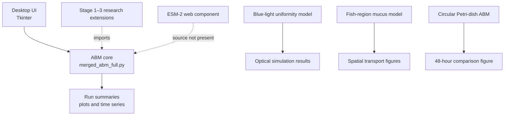

# Software architecture

The desktop application is the primary user-facing entry point. It imports the ABM module directly. The other simulation files are independent programs. Stage scripts extend or wrap the ABM for research experiments and are kept outside the primary application path.

This diagram describes the organized source tree. It does not claim that the stage experiments or the ESM-2 web component have been integrated or validated.
